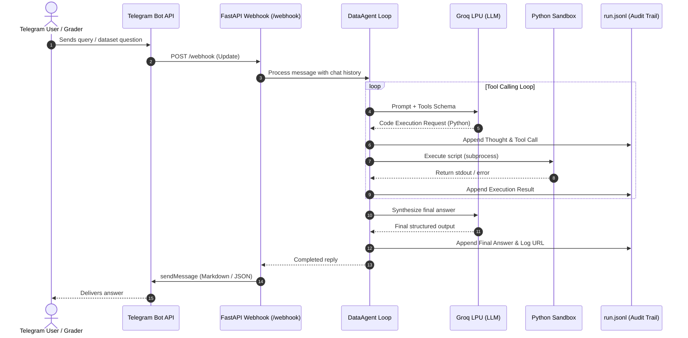

# 🤖 TDS Autonomous Data Analysis Telegram Agent

[](https://www.python.org/)
[](https://fastapi.tiangolo.com/)
[](https://groq.com/)
[](https://core.telegram.org/bots/api)
[](https://railway.app/)

An autonomous, tool-calling Telegram bot engineered to solve complex data analysis tasks over real-world datasets on the fly. Built with **FastAPI**, powered by **Groq LPU inference**, and featuring a recursive Python code-execution sandbox with live **public audit logging (`.jsonl`)**.

---

## 🌟 Key Highlights

- **⚡ Low-Latency Agentic Reasoning:** Leverages Groq's LPU inference for high-speed chain-of-thought analysis and tool calling.
- **🐍 Autonomous Code Execution Sandbox:** Writes and executes dynamic Python (Pandas, Numpy, HTTPX) scripts in a sandboxed subprocess to inspect datasets and compute verified answers.
- **📜 Evaluator-Grade Public Audit Logging:** Automatically logs thought steps, tool calls, and outputs to an append-only `logs/run.jsonl` served publicly via `GET /logs/run.jsonl` (downloadable via `wget`/`curl`).
- **🎯 Dual-Mode Responses:**
  - **Conversational Mode:** Natural language dialogue with multi-turn memory for casual queries.
  - **Structured Evaluation Mode:** Strict 2-key JSON output (`{"answer": <result>, "log_url": "<url>"}`) strictly adhering to IITM automated evaluator specifications.
- **🚀 Cloud Native:** Zero-downtime webhook architecture packaged for one-click deployment on Railway.

---

## 🧠 Beyond an LLM Wrapper: True Agentic Architecture
Many chatbot projects are simple **LLM wrappers**—they take raw user input, pass it to a single completion endpoint, and blindly relay whatever the model generates. 
This project is a **full-fledged autonomous agent (`DataAgent`)**. It operates using an iterative **ReAct (Reason + Act)** control loop with sandboxed tool invocation, dynamic self-correction, and stateful memory:
### 1. 🛠️ How Tools are Handled
The agent has native access to an isolated execution tool: **`execute_python`** (`tools/python_runner.py`):
- **Tool Registration:** Tool interfaces are exposed to the LLM via OpenAI/Groq-compatible JSON schemas (`tools/__init__.py`).
- **Dynamic Code Synthesis:** When presented with complex mathematical, tabular, or external data questions (e.g. MOSPI datasets, multi-step statistics), the agent **does not hallucinate calculations**. Instead, it generates executable Python code leveraging libraries like `pandas`, `numpy`, and `httpx`.
- **Subprocess Isolation:** The Python code is written to a temporary workspace and executed inside an isolated OS subprocess via `subprocess.run()`. Both standard output (`stdout`) and error streams (`stderr`) are captured.
- **Runtime Self-Correction:** If the executed code fails (e.g., unexpected missing columns, data-type mismatches, or network timeouts), the agent intercepts the traceback error, diagnoses what went wrong, writes a revised script, and re-runs it automatically until a valid answer is computed.
### 2. 💾 How Memory is Stored & Utilized
The bot does not treat interactions as one-off stateless prompts:
- **Per-Chat Session Isolation:** Memory is maintained per individual `chat_id`, keeping conversations isolated and secure across multiple concurrent users.
- **Contextual Turn Tracking:** The agent logs the entire interaction trajectory—user prompts, internal assistant reasoning, tool invocation requests, and tool execution outputs (`role: "tool"`).
- **Multi-Turn Reasoning:** Users can naturally ask iterative questions (e.g., *"What is the top state?"* followed by *"Now calculate the standard deviation for that state's last 5 years"*). The agent uses its accumulated session memory to reference previous datasets and results without requiring the user to restate the problem.
### 3. 📜 Public Observable Audit Trail
Every internal thought, tool call, script payload, runtime output, and final synthesis is appended to `logs/run.jsonl` in strict JSONL format. This public audit trail allows graders and evaluators to inspect the agent's exact decision tree in real time via `GET /logs/run.jsonl`.

---

## 🏗️ Architecture & Workflow



---

## 📁 Repository Structure

```text
p1-telegram-bot/
├── agent/
│   ├── agent.py          # Core DataAgent loop & prompt management
│   └── logger.py         # Thread-safe JSONL audit trail logger
├── bot/
│   ├── handlers.py       # Telegram update & message routing
│   └── telegram.py       # Asynchronous Telegram HTTP API client
├── llm/
│   └── groq_provider.py  # Groq client integration & tool definitions
├── tools/
│   ├── __init__.py       # Tool registry & OpenAI-compatible schemas
│   └── python_runner.py  # Sandboxed Python code executor (subprocess)
├── logs/
│   └── run.jsonl         # Publicly served execution audit log
├── app.py                # FastAPI server, webhook & static log route
├── requirements.txt      # Python dependencies
├── railway.json          # Railway deployment configuration
└── .env.example          # Template for environment variables
```

---

## 🔌 API Endpoints

| Method | Endpoint | Description |
| :--- | :--- | :--- |
| `POST` | `/webhook` | Receives real-time update payloads from Telegram. |
| `GET` | `/logs/run.jsonl` | Serves the full execution audit log (wget-able for graders). |
| `GET` | `/health` | Service liveness probe. |

---

## 🛠️ Environment Variables

Create a `.env` file in the project root (or configure under **Variables** in Railway):

| Variable | Required | Description | Example |
| :--- | :---: | :--- | :--- |
| `BOT_TOKEN` | **Yes** | Telegram Bot API token from [@BotFather](https://t.me/botfather) | `8617928520:AAGh...` |
| `WEBHOOK_URL` | **Yes** | Public HTTPS base URL where the bot is hosted | `https://p1-telegram-bot.up.railway.app` |
| `GROQ_API_KEY` | **Yes** | GroqCloud API key | `gsk_...` |
| `GROQ_MODEL` | No | Active Groq model identifier *(default: `llama-3.1-8b-instant`)* | `llama-3.1-8b-instant` |
| `PORT` | No | Port for Uvicorn server *(injected automatically on Railway)* | `8000` |

---

## 🚀 Local Development Setup

### 1. Clone & Set Up Virtual Environment

```bash
git clone https://github.com/<your-username>/p1-telegram-bot.git
cd p1-telegram-bot
python -m venv venv

# Windows
venv\Scripts\activate

# Linux / macOS
source venv/bin/activate
```

### 2. Install Dependencies

```bash
pip install -r requirements.txt
```

### 3. Configure Environment

```bash
cp .env.example .env
# Edit .env with your BOT_TOKEN and GROQ_API_KEY
```

### 4. Run with Webhook Tunnel (e.g. ngrok or Cloudflare)

Since Telegram requires a public HTTPS URL for webhooks:

```bash
# Terminal 1: Start tunnel
ngrok http 8000

# Terminal 2: Run FastAPI server (set WEBHOOK_URL to your ngrok URL in .env)
uvicorn app:app --host 0.0.0.0 --port 8000 --reload
```

---

## 🚢 Production Deployment (Railway)

1. Connect your repository to **Railway**.
2. Railway detects `railway.json` and builds the environment automatically.
3. In the Railway dashboard under **Variables**, define:
   - `BOT_TOKEN`
   - `WEBHOOK_URL` (`https://<your-railway-domain>.up.railway.app`)
   - `GROQ_API_KEY`
   - `GROQ_MODEL` (`llama-3.1-8b-instant`)
4. Upon container startup, `app.py` automatically registers the webhook with Telegram (`/setWebhook`).